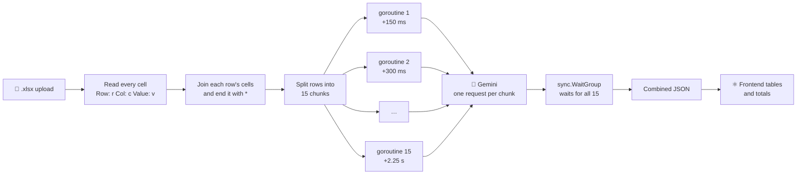
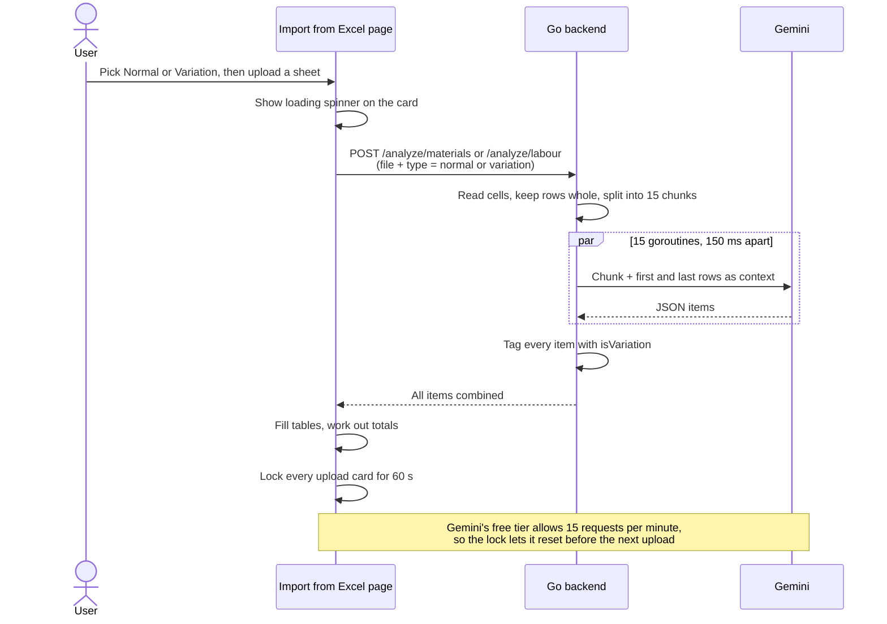
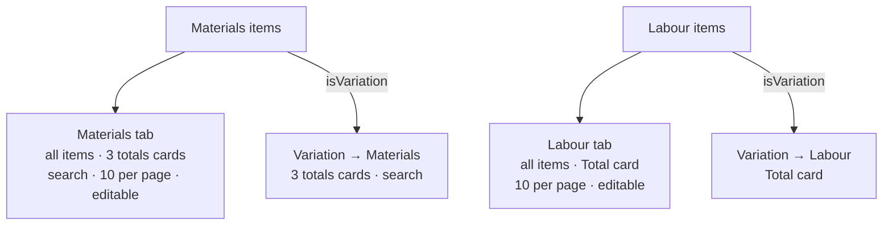
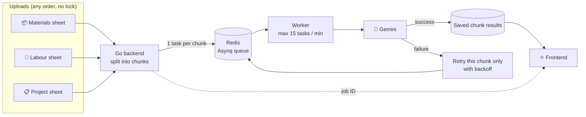
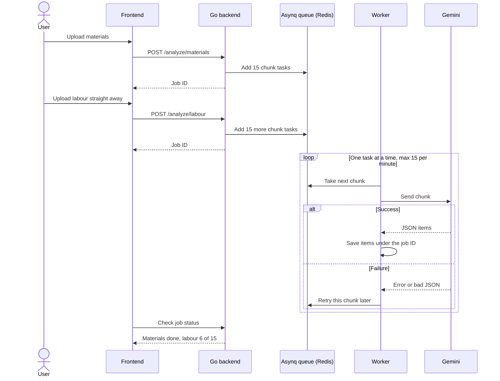

# 🏗️ Parserbooks

A full-stack construction and project management app for tracking project financials, labour, materials, maintenance, and invoice entry.

---

## ⚡ Getting Started

1. Install [Docker](https://www.docker.com/products/docker-desktop/).
2. From the project root, run:

   ```bash
   docker compose up --build
   ```

   This starts the database, Adminer, the backend API, and the frontend.

| Service | URL |
|---|---|
| Frontend | http://localhost:5173 |
| Backend API | http://localhost:8080 |
| Postgres | localhost:5432 |
| Adminer (DB UI) | http://localhost:8081 |

---

## 🚀 Features

### 📊 Project Management
* **Project Summary** — tracks projects, materials, and labour from Postgres, with contract values, variations, material/labour costs, and profit/margin.
* **Project Summary Entry** — create projects, add labour entries, add material entries.
* **Maintenance Schedule** — add, view, and delete property maintenance records.

### 🤖 AI-Assisted Entry
* **Invoice Scanner** — upload an invoice PDF and the backend extracts its text and sends it to Google Gemini to pull out supplier, date, invoice number, and line items, ready to drop into the materials register.
* **Excel Ingestion** — on the Import from Excel page:
  * **Project Details** — the spreadsheet is parsed cell by cell and sent to Gemini, which returns project name, client, address, dates, contract amounts, actual costs, and profit/margin as JSON. The backend encodes it into a Go struct and sends it to the frontend, where it fills in the project preview form. Dates are converted to `yyyy-mm-dd` so the date inputs can show them. Every field in the form can be edited before saving.
  * **Materials** — each row is read with its cells kept together, then the rows are split into 15 chunks and sent to Gemini at the same time using goroutines. Gemini returns product code, date, supplier, invoice, quantity, description, unit price, total, whether the total includes GST, and the sheet's markup. The first and last rows of the sheet are sent along as context only, so Gemini can find the markup without turning those rows into items.
    * The rows appear in a table with Ex GST, Net Ex GST, GST, Total, and Total With Markup worked out per item, plus cards for Total Ex GST, Total Inc GST, and Total Inc GST With Markup.
    * The table shows 10 items per page, with Prev/Next buttons and a page number box, and can be searched by description.
    * Date, product code, supplier, invoice, description, quantity, and markup can be edited in place. The cells look like plain text, and the worked-out columns and totals update as you edit.
  * **Labour** — the labour sheet goes through the same pipeline as Materials: rows are kept whole, split into 15 chunks, and sent to Gemini in parallel goroutines. Gemini returns date, worker, rate, hours, total, type, and notes for each row, using a labour-specific prompt with the same strict rules (no guessing between columns, `""` or `0` for missing fields, never null).
    * The rows appear in a table that shows 10 items per page, with the same page controls as Materials.
    * A Total card adds up every row's total, so it matches the sheet.
    * Every field can be edited in place, and Type is a dropdown of Normal or Overtime.
  * **Normal and variation uploads** — the Materials and Labour upload cards each have a Normal / Variation toggle. Its setting is sent with the file, and the backend tags every item from that upload as variation or not. Materials and labour uploaded as variation also show up under the Variation tab:
    * **Variation materials** get the same three totals cards as Materials (Total Ex GST, Total Inc GST, Total Inc GST With Markup), can be searched by description, and show Ex GST, GST, and Total for each item.
    * **Variation labour** gets the same Total card as Labour.
  * **Upload cooldown** — while a materials or labour file is processing, its card shows a loading spinner. Once the results arrive, every upload card is locked for 60 seconds behind a countdown bar, so the next upload doesn't go over Gemini's 15 requests per minute.
  * **Exact math** — totals are worked out from unrounded values and only rounded to 2 decimals when shown on screen, so they stay as close to the spreadsheet as possible. Expenses are stored unrounded for the same reason.

### 📅 Operations & Accounting
* **Work Calendar** — daily worker hours and project assignments.
* **Quotations Register** — client quotes, references, statuses, sent-via channels.
* **Request for Quotation (RFQ)** — a page for pasting client emails and drafting a quote from them; currently a static layout, not wired to extraction or the Quotations register yet.
* **Accounts Payable & Expenses** — supplier bills and operating expenses, with GST calculation.
* **Payroll** — employee records, rates, PAYG, super.

---

## ⏱️ Milestone: Materials ingestion 80% faster

Materials ingestion used to send the whole sheet to Gemini in one request, and a single test sheet took **35–38 seconds** to come back.

| | Before | After |
|---|---|---|
| Requests to Gemini | 1 | 15, in parallel |
| Wait on the same test sheet | **35–38s** | **7s** |

It now works like this:



1. **Rows are kept whole.** Each row's cells are joined and marked with a `*` separator, so a chunk never cuts a row in half.
2. **The sheet is split into 15 chunks**, one for each request Gemini's free tier allows per minute.
3. **Each chunk runs in its own goroutine.** The requests are staggered 150 ms apart so they don't all land at once, and a `sync.WaitGroup` waits for all of them before the combined results are sent to the frontend.

On the same sheet, the wait went from **35s to 7s, an 80% decrease**.

**Trade-off:** one upload uses up the free tier's 15 requests for that minute, so uploads are locked for 60 seconds afterwards while Gemini resets.

Labour ingestion was built on the same pipeline, so labour sheets get the same speed-up.

---

## 🔀 How an upload flows

Every materials or labour upload follows the same path, from the Normal / Variation toggle to the 60-second lock:



Once the items arrive, the `isVariation` tag decides which tabs they show up in:



---

## 📬 Planned: Background queue with Asynq

The 60-second lock keeps the app under Gemini's free-tier limit of 15 requests per minute, but it has two costs:

* **Waiting.** After one upload, every card is locked. You can't queue your labour sheet while materials are still cooling down.
* **Wasted requests on failure.** All 15 chunk requests run as one batch. If one chunk fails, the only fix today is to upload the whole sheet again, which re-sends the 14 chunks that already worked.

The plan is to move chunk processing onto [Asynq](https://github.com/hibiken/asynq), a Redis-backed task queue for Go.

### How it would work

1. **Uploads go straight onto the queue.** The backend reads the sheet and splits it into chunks as it does now. Instead of calling Gemini directly, it adds one task per chunk to the queue and returns a job ID right away. Materials, labour, and project uploads can all be added back to back, with no lock on the upload cards.
2. **One worker drains the queue at Gemini's pace.** A single worker takes tasks one after another and is rate-limited to 15 per minute. Uploads simply wait their turn in the queue, instead of the user waiting at a locked screen.
3. **Each chunk retries on its own.** Every chunk is its own task, so if one fails (a timeout, a rate-limit error, or JSON that won't parse), Asynq retries only that chunk, with a delay between tries. Chunks that already succeeded are never sent again, so no credits are spent redoing finished work.
4. **Results are saved per chunk.** Each finished chunk's items are stored under its job ID as soon as they come back. When every chunk in a job is done, the job is marked complete.
5. **The frontend follows progress.** The upload card shows something like "Materials: 9 of 15 chunks done" by checking the job's status, and fills the table once the job is complete.





### What changes

| | Now | With Asynq |
|---|---|---|
| Uploading a second sheet | Locked for 60 seconds | Added to the queue right away |
| Staying under 15 requests per minute | Enforced by locking the UI | Enforced by the worker's rate limit |
| One chunk fails | Upload the whole sheet again | Only that chunk is retried |
| Gemini requests for one failed chunk | 15 | 1 per retry |
| Closing the tab mid-upload | Results are lost | Tasks keep running; results are saved by job ID |

### What it needs

* **Redis**, added as a service in `docker-compose.yml`.
* **A worker process** running Asynq's server alongside the API.
* **Somewhere to keep results**: a jobs table in Postgres, or Redis, keyed by job ID.
* **A status route** such as `GET /jobs/{id}` for the frontend to check.

**Trade-off:** a single upload won't come back faster than it does today, and may take longer, because the worker paces requests over the minute instead of firing all 15 at once. The win is that uploads no longer block each other, and a failure costs one chunk instead of the whole sheet.

---

## 🗺️ Roadmap

* **Background queue with Asynq** — replace the 60-second lock with a Redis-backed queue so uploads can be stacked, and retry only the chunks that fail. See [the plan above](#-planned-background-queue-with-asynq).
* **Save to Project Summary** — write the extracted project, materials, and labour data into Postgres.
* **Variation tab** — add editing to the variation tables, and decide whether variation items should also stay in the main Materials and Labour tabs.

---

## 🛠️ Tech Stack

* **Frontend:** React, Vite, TypeScript, Tailwind CSS, react-router-dom
* **Backend:** Go (goroutines + `sync.WaitGroup` for concurrent Gemini requests), PostgreSQL
* **File storage:** Supabase Storage
* **AI:** Google Gemini
* **Excel parsing:** tealeg/xlsx
* **Infra:** Docker, Docker Compose

---

## 🧭 Not built yet

* Completed Jobs, Customer Invoices, and Xero: no backend routes, dead sidebar links.
* ServiceM8: page exists, no integration logic.
* RFQ email parsing and a variation-document parsing engine.
* Login and user accounts. The app currently runs against a single fixed user.
* Editing saved records. Only employees can be edited after creation; everything else can be added or deleted but not edited. (Imported project, materials, and labour data can be edited on the Import from Excel page before it's saved.)
